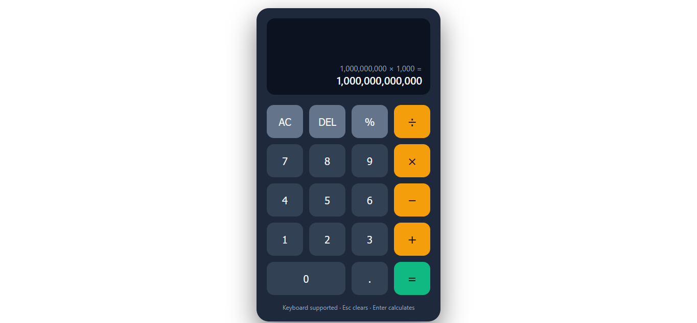
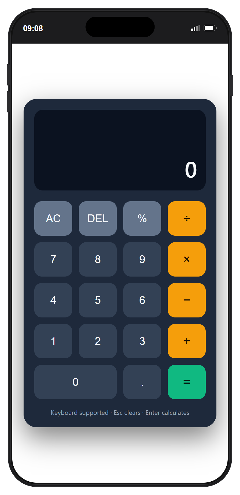

# CodeAlpha_Calculator

A responsive calculator built with plain HTML, CSS and JavaScript as part of the CodeAlpha Frontend Development internship (Task 2).

## Features

- Addition, subtraction, multiplication and division
- Clear (AC), delete (DEL) and percent (%)
- Live display of the full expression as you type it (`3 + 4 − 12 − 5`), kept on screen with the result after `=`
- Correct order of operations (`2 + 3 × 4 = 14`)
- Decimal input with duplicate-point protection
- Division by zero handling
- Floating point cleanup (`0.1 + 0.2 = 0.3`)
- Full keyboard support
- Responsive layout for phones and desktops

## Keyboard Shortcuts

| Key | Action |
|---|---|
| `0-9` | Enter digits |
| `.` | Decimal point |
| `+ - * /` | Operators |
| `Enter` or `=` | Calculate |
| `Backspace` | Delete last digit |
| `Esc` or `C` | Clear all |
| `%` | Percent |

## Tech Stack

HTML5, CSS3 (Grid, custom properties), vanilla JavaScript. No frameworks, no `eval()`.

## Run Locally

Open `index.html` in your browser. No build step needed.

## Live Demo

- [Live demo](https://codealphacalculator-zeta.vercel.app)
- [GitHub repository](https://github.com/brah14/CodeAlpha_Calculator)

## Screenshots

### Desktop

### Mobile

## Quick Test Checklist

- `2 + 3 × 4 =` displays `14`.
- `0.1 + 0.2 =` displays `0.3`.
- `8 ÷ 0 =` displays a clear divide-by-zero message.
- Press `=` again after `5 + 2 =` to get `9`.
- Test mouse/touch controls and the keyboard shortcuts listed above.

## Author

Wisdom Huno Tetteh — [GitHub](https://github.com/brah14)
